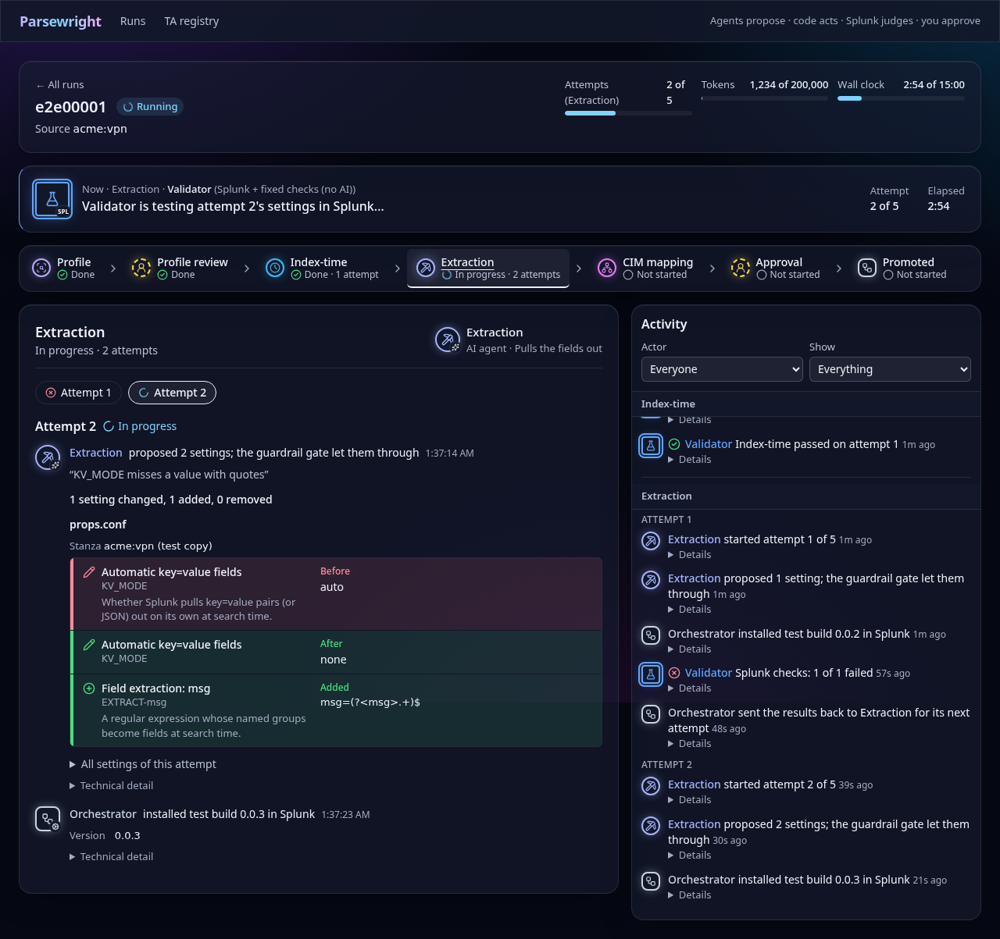

# Parsewright

From raw sample logs to a tested, CIM-compliant Splunk add-on, verified by Splunk rather than by the model.

[](https://github.com/MKhalafHammad/Parsewright/actions/workflows/ci.yml)
[](LICENSE)

> **Status:** hackathon build. This README separates what is **built** from what is **planned**. Built: the full loop (three agent stages, each checked by a real Splunk, on JSON, key=value, syslog and CSV logs), the job queue with parallel workers, the agent-centred web UI, hash-bound approval and promotion, parser updates of promoted TAs, and a one-command Docker setup that prepares its own Splunk. Planned: drift monitoring and shared-feed routing.

## Demo

- Demo video: _planned (link added at submission)_
- Screenshot (synthetic data): the run workspace mid-run, with the agent at work, the phase rail and what attempt 2 changed.

  

## What it does

**The problem.** Every new data source in a SOC needs a parser. Someone has to work out line breaking, timestamps, field extractions and CIM mapping. Writing and testing `props.conf` and `transforms.conf` by hand takes hours per source, and index-time mistakes corrupt data permanently.

**The solution.** You give Parsewright sample logs from one source. A team of Muse Spark agents studies them and writes the Splunk add-on (TA) one stage at a time. Parsewright deploys each attempt to a standalone Splunk Enterprise instance and ingests the samples into a throwaway test index. Fixed Splunk searches then check the result. When a check fails, the owning agent gets the evidence and tries again. When everything passes, a human reviews raw vs parsed events and approves. The result is a `TA-parsewright-<vendor>-<product>.tgz`.

## How it works

The guiding principle is **agents propose, code acts, Splunk judges**:

- **Agents propose.** Muse Spark agents only reason and return schema-validated config proposals. They can run read-only searches, but they never deploy anything.
- **Code acts.** A deterministic orchestrator (a state machine, not an AI manager) gates every proposal through guardrails, then deploys and ingests.
- **Splunk judges.** A Validator made of code and fixed SPL, with no AI, decides pass or fail. Agents never grade themselves.

```
 samples ──► Profiler ──► [human: profile review]
                │
                ▼
      ┌──► Index-time agent ──► guardrails ──► deploy + ingest ──► Validator (SPL) ─┐
      │    Extraction agent        (code)        (pw_* test index)    pass? next   │
      │    CIM mapper agent                                            fail? retry  │
      └──────────────────────────── evidence (expected vs actual) ◄────────────────┘
                │
                ▼
     [human: approve] ──► TA-parsewright-<vendor>-<product>.tgz
```

Each stage retries at most 5 times within a token and time budget. If the budget runs out, the run stops with an honest report of what it could not solve. The full design is in [docs/design.md](docs/design.md).

## Meta models used

| Model | Used for |
| --- | --- |
| Muse Spark (`muse-spark-1.3`, standard mode) via the Meta Model API | All agent reasoning: profiling, index-time settings, field extraction, CIM mapping |
| Muse Spark Open | **On-prem mode**: the same code with a different `LLM_BASE_URL`, so logs never leave your network |
| Muse Code | Speeding up development of this project |

The model is set only through environment variables (`LLM_BASE_URL`, `LLM_MODEL`, `LLM_API_KEY`), never in code.

## Features

| Feature | Status |
| --- | --- |
| Repository foundation: CI, secret scanning, commit hooks | **Built** |
| One-command Docker stack (`make up`): Splunk, PostgreSQL, engine and UI; Splunk prepared automatically (test index, least-privilege roles and tokens, CIM add-on and macros) | **Built** (clean-machine test pending) |
| Threat model and lab probes for the Meta Model API and Splunk ([docs/lab-findings.md](docs/lab-findings.md)) | **Built** (all lab questions answered) |
| Synthetic log generator with truth manifests (JSON, key=value, syslog, CSV) | **Built** |
| Profiler agent, with a human profile review in the UI (or skipped per run) | **Built** |
| Index-time agent with a retry loop fed by Validator evidence | **Built** |
| Extraction and CIM mapper agents with retry loops, regression re-runs and one backtrack | **Built** |
| Guardrails: stage gates plus a final gate over the whole package (allowlisted keys after Unicode normalisation, no forbidden keys, no foreign stanzas, eventtype anchoring, CIM provenance, environment-independent EVALs), with an adversarial suite of 87 tests | **Built** |
| Validator: index-time checks (event count, timestamp accuracy, fallback, parser warnings, `TIME_FORMAT` really matching every event) | **Built** |
| Validator: extraction and CIM checks (Authentication, Network_Traffic, Web) with the three-number CIM score | **Built** |
| TA builder: escaping conf writer, test identity, reproducible `.tgz` packaging with a file allowlist and SHA-256 | **Built** |
| Approval and promotion: `parsewright approve <job> --sha256 …` (hash-bound, replay-safe), `parsewright promote <job>` (deterministic rename to real names, both hashes linked, refuses existing TAs and sourcetypes, smoke test) | **Built** |
| CLI: `parsewright run <file>` (all three stages) | **Built** |
| Web UI (Next.js): runs board with "Needs you" and a new-run sheet; run workspace with a clickable, deep-linkable phase rail, every attempt's proposal, gate verdict and Splunk checks, and a live activity feed showing which agent is acting; profile review; approval report (raw vs parsed with field colours and a CIM view, readable config and row diffs, approve/reject, `.tgz` download); TA registry | **Built** |
| Parallel jobs: PostgreSQL queue (`FOR UPDATE SKIP LOCKED`, leases, heartbeats, crash resume), append-only ledger, worker pool with a global Splunk-write lock, LLM slots, daily token budget and kill switch | **Built** |
| HTTP API: upload (content checks, duplicates), runs, profile review, approve/reject, `.tgz` download, live server-sent events; `parsewright serve` | **Built** (no login: localhost only, residual risk R1) |
| Routing for shared syslog feeds | Planned (stretch) |
| Parser updates: TA registry (versions, samples, baseline); `parsewright update <TA> <file>` or the upload form; Diagnose with no model call (0 tokens if the TA already parses the new format); only failing stages patched; every attempt checked on the old and the new samples; diff against production and `local/` override flags in the review; in-place promotion with a version bump that keeps `local/`; exact-version `parsewright rollback` | **Built** |
| Drift monitoring with automatic update jobs | Planned (stretch) |

## Prerequisites

- **OS:** Linux or macOS. On Windows, use WSL2.
- **Docker Engine 24+** with **Docker Compose v2.20+** (`docker compose version`).
- **Memory and disk for Splunk:** at least 8 GB of RAM free for Docker (4 GB is the bare minimum), and at least 20 GB of free disk. Splunk pauses indexing when free disk drops below 5 GB.
- **Architecture:** the Splunk image is x86-64. On Apple Silicon it runs under emulation and is slower.
- **`make` and Python 3.10+** on the host (the setup scripts use the standard library only).
- **A Meta Model API key.**
- **The Splunk Common Information Model add-on** `.tgz` from Splunkbase (free account; it is licensed by Splunk, so it is not bundled). See [lab/README.md](lab/README.md).
- For development: Python 3.12+ and Node 24, plus [gitleaks](https://github.com/gitleaks/gitleaks) and [semgrep](https://semgrep.dev/) for `make security`.

## Quick start

About 15 minutes on a fresh machine, most of it Splunk's first start.

1. Clone the repository:
   ```bash
   git clone https://github.com/MKhalafHammad/Parsewright.git
   cd Parsewright
   ```
2. Create `.env` and put your Meta Model API key in it:
   ```bash
   make env        # creates .env from .env.example and generates every password
   ```
   Then edit `.env` and set `LLM_API_KEY`. Nothing else needs a value: the passwords are generated, and the Splunk tokens are created in step 4. Never commit `.env`.
3. Put the CIM add-on in `lab/`: download "Splunk Common Information Model (CIM)" from Splunkbase and save the `.tgz` there, keeping its name ([lab/README.md](lab/README.md)).
4. Start everything:
   ```bash
   make up         # DOCKER="sudo docker" make up   if your user cannot reach Docker
   ```
   Always start the stack with `make up`, not `docker compose up` directly: `make up` replaces the placeholder passwords first. It starts Splunk and PostgreSQL, then prepares Splunk inside its own container: the `pw_test` index, three service accounts with least-privilege roles (search, deploy, drift), the CIM add-on with its index macros pointed at `pw_*`, and one fresh token per account, written into `.env` and never printed. Then it starts the engine and the web UI. Every port is bound to `127.0.0.1`.
5. Start the first run with the bundled synthetic VPN log:
   ```bash
   make first-run
   ```
   It prints the run's page. Open http://localhost:3000 and watch the agents work: Profiler, then Index-time, Extraction and CIM mapping, each attempt checked in Splunk. When it reaches "Awaiting approval", review raw vs parsed and the configuration, then approve or download the `.tgz`.

Splunk Web is at http://localhost:8000 (user `admin`, password `SPLUNK_PASSWORD` from `.env`). `make down` stops the stack; `docker compose down -v` also deletes its data.

**Without Docker, against your own Splunk** (the lab setup): follow [docs/lab-findings.md](docs/lab-findings.md), "Lab setup", set `SPLUNK_HOST`, `SPLUNK_PORT` and the three tokens in `.env`, then `make setup` and `.venv/bin/parsewright serve`.

## Configuration

Every setting lives in `.env`. [.env.example](.env.example) documents each variable: what it is, whether it is required and where to get it. Docker Compose reads `.env` and refuses to start if a required value is missing.

**Using a self-hosted Muse Spark Open (on-prem mode).** Run Muse Spark Open behind an OpenAI-compatible endpoint inside your network. Then point Parsewright at it:

```bash
LLM_BASE_URL=https://llm.example.com/v1
LLM_MODEL=<model name your server exposes>
LLM_API_KEY=<key your server expects, or any placeholder if none>
```

Nothing else changes, and sample logs never leave your network.

## Usage

**Web UI** (http://localhost:3000)
1. **New run:** upload sample logs from one source (JSON, key=value, syslog or CSV; at least 50 events, at most 10 MB), with an optional truth manifest, vendor, product and timezone. Or choose a promoted TA to update it for a new log format.
2. **Profile review:** confirm or correct what the Profiler found (vendor, product, sourcetype, timezone), with field coverage shown.
3. **Run workspace:** the "Now" banner names the agent at work; the phase rail opens any phase and attempt (`/runs/<job>?phase=extraction&attempt=2`). Each attempt shows the proposal, the guardrail gate's verdict, Splunk's checks (expected vs actual, failing events) and what changed since the previous attempt. The activity feed is grouped by phase and attempt.
4. **Approval report:** CIM scores, attempts per phase and holdout; raw vs parsed with one colour per field and a CIM view; the configuration as the `.conf` files themselves. Approve (bound to the package's SHA-256, with a second confirmation), reject, or download the `.tgz`.

**CLI**
```bash
.venv/bin/parsewright run engine/parsewright/generator/fixtures/acme_vpn.json --vendor acme --product vpn
.venv/bin/parsewright update TA-parsewright-acme-fw new_format.log
.venv/bin/parsewright approve <job> --sha256 <hash> && .venv/bin/parsewright promote <job>
```
The CLI runs the same pipeline headless against the Splunk in `.env` and prints each attempt, check and the CIM score.

## Running tests and security checks

```bash
make test      # pytest (engine and repo tooling)
make lint      # all pre-commit hooks over all files: ruff, gitleaks, file checks
make security  # bandit, semgrep, pip-audit, npm audit, gitleaks over full git history
```

`make security` needs `gitleaks` and `semgrep` on your PATH:

```bash
brew install gitleaks          # or: go install github.com/zricethezav/gitleaks/v8@v8.30.1
pipx install semgrep           # kept out of the project venv to avoid dependency clashes
```

CI runs `make lint`, `make test` and `make security` on every pull request (not on plain branch pushes). Any failure fails the build.

## Security

- Report vulnerabilities privately; see [SECURITY.md](SECURITY.md).
- `.env` is git-ignored and never committed. gitleaks scans every commit and the full history in CI.
- **Do not upload real production logs to a hosted model.** Use the synthetic generator, mask your data, or use on-prem mode with Muse Spark Open.
- **Guardrails** (see [docs/design.md](docs/design.md), "Guardrails and security"):
  - Agents cannot deploy. Every proposal passes a deterministic gate with a key allowlist and value checks. That gate blocks `nullQueue`, index rerouting, `INGEST_EVAL`/`SEDCMD`, `[default]` stanzas and newline injection, and runs a regex backtracking test; after install, any splunkd parsing warning for the test add-on fails the attempt.
  - Test deploys use separate app and sourcetype names and `pw_*` indexes only.
  - Approval is bound to the SHA-256 of the exact `.tgz`.
  - Logs are treated as data, never as instructions.

## Project structure

```
.
├── engine/                  Python backend (package: parsewright)
│   ├── parsewright/
│   │   ├── api/             FastAPI routes, upload checks and the SSE stream (built)
│   │   ├── orchestrator/    three-stage run loop, workers, approval and promotion (built)
│   │   ├── agents/          LLM client, Profiler, Index-time, Extraction, CIM mapper (built)
│   │   ├── tools/           lab probes, Splunk client, search guard, test_regex (built)
│   │   ├── guardrails/      index-time and search-time gates, final package gate, adversarial suite (built)
│   │   ├── validator/       index-time, extraction and CIM checks (built)
│   │   ├── ta_builder/      escaping conf writer, naming, .tgz packaging (built)
│   │   ├── ledger/          PostgreSQL job queue and append-only ledger (built)
│   │   ├── cim_spec/        CIM 8.7.0 required fields and allowed values, pinned from Splunk_SA_CIM (built)
│   │   └── generator/       synthetic logs in four formats + truth manifests; fixtures/ (built)
│   └── tests/               engine tests
├── web/                     Next.js + shadcn/ui UI (built)
├── docs/                    design.md (source of truth), build-plan.md, threat-model.md, lab-findings.md
├── scripts/                 one-command setup (up.sh, Splunk bootstrap), first run, commit-msg hook
├── lab/                     licensed add-ons you download (CIM); git-ignored packages
├── demo/                    repeatable scripts for each demo moment
├── tests/                   repo tooling tests
├── .claude/                 project settings and subagents for Claude Code
├── .github/workflows/       CI
├── docker-compose.yml       Splunk Enterprise, PostgreSQL, engine, web
├── Makefile                 env, up, first-run, down, logs, setup, test, lint, security
└── .env.example             every variable, placeholders only
```

## Troubleshooting

- **Splunk is slow to start.** The first start takes several minutes while the container provisions itself. Follow it with `make logs` (or `docker compose logs -f splunk`). Wait for `docker compose ps` to show `healthy`.
- **Splunk exits right away mentioning the license or general terms.** `SPLUNK_START_ARGS=--accept-license` and `SPLUNK_GENERAL_TERMS=--accept-sgt-current-at-splunk-com` must both be set in `.env`. Setting them means you accept the Splunk license and terms.
- **Splunk rejects the admin password.** `SPLUNK_PASSWORD` needs at least 8 characters. If you change it after the first start, the old password stays in the `splunk-etc` volume. Run `docker compose down -v` to reset, which **deletes all Splunk and PostgreSQL data**.
- **Port already in use.** Change `SPLUNK_WEB_PORT` or `WEB_PORT` in `.env`, then run `make down && make up`.
- **`required variable ... is missing a value`.** A required `.env` value is empty or missing. Compare your `.env` with `.env.example`.
- **`make up` stops at "preparing Splunk" with "no package is in lab/".** Download the CIM add-on into `lab/` (step 3), then run `make up` again; every step is safe to repeat.
- **The engine logs 401 from Splunk.** The service tokens last 7 days. Run `make up` again: it replaces all three.
- **Meta API errors:**
  - 401/403: check `LLM_API_KEY`.
  - 404: check `LLM_BASE_URL` and `LLM_MODEL`.
  - 429: you hit a rate limit or used up your credits. Check the spend limit on your Meta billing page.

## Hackathon note

Parsewright was built during the **Meta Global AI Developer Hackathon** (building period Oct 27 – Nov 4, 2026), "Build for Your World" track. All code in this repository is written during the event, starting with the first commit on Oct 27, 2026. Only synthetic logs are used. The demo shows only features built during the event.

Progress per phase is tracked in the Status table of [docs/build-plan.md](docs/build-plan.md).

## Limitations and roadmap

**Hackathon scope:**
- One standalone Splunk Enterprise instance.
- Four formats: JSON, key=value, syslog, CSV.
- Three CIM data models: Authentication, Network_Traffic, Web.

**Out of scope for now:**
- Splunk Cloud, clusters and forwarders.
- Writing `inputs.conf`.
- XML and binary formats.
- Updating TAs that Parsewright did not build.

**Roadmap (after the core loop):**
- Routing for shared syslog feeds.
- Drift monitoring with automatic update jobs.
- A `pw_audit` index and dashboard.
- Login with an approver role.
- Pinned dependencies with hashes, and base images pinned by digest.

See [docs/design.md](docs/design.md) for details and open questions.

## License

[MIT](LICENSE) © 2026 Mohamed K. Hammad
