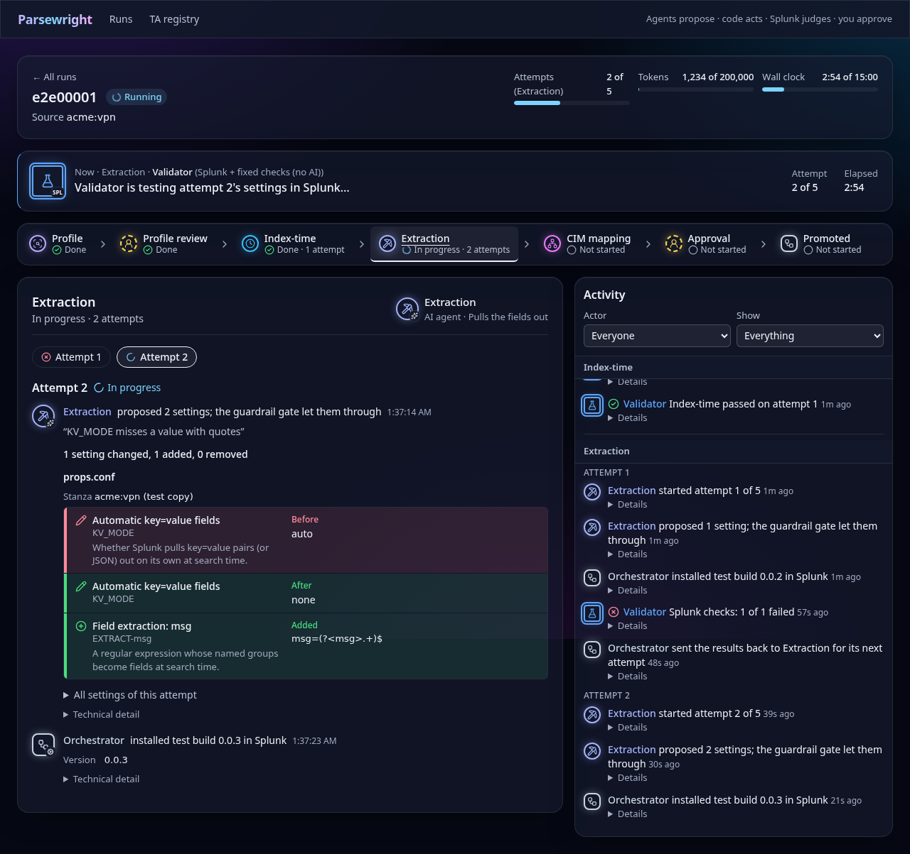
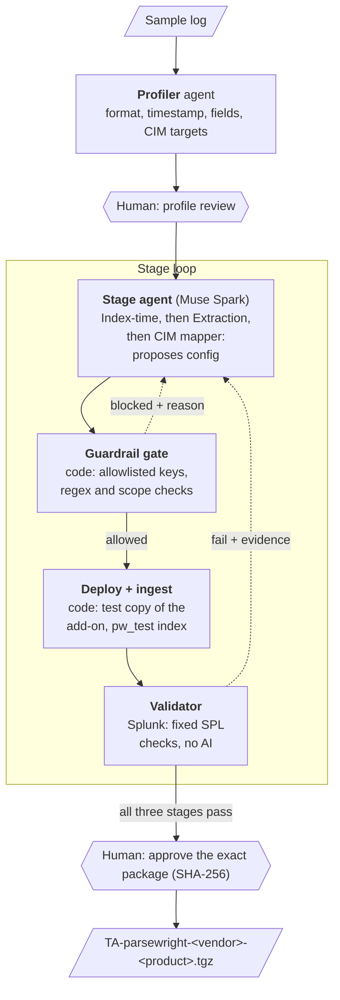
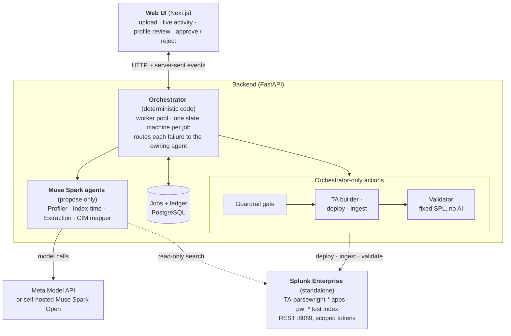

# Parsewright

From raw sample logs to a tested, CIM-compliant Splunk add-on, verified by Splunk rather than by the model.

[](https://github.com/MKhalafHammad/Parsewright/actions/workflows/ci.yml)
[](LICENSE)

- **Demo video:** [watch the 3-minute demo on YouTube](https://www.youtube.com/watch?v=WsxSCXF_JRs)
- Built for the **Meta Global AI Developer Hackathon** (Oct 27 – Nov 4, 2026), "Build for Your World" track. All code was written during the event, from the first commit on Oct 27; only synthetic logs are used, and the demo shows only features built during the event. Progress per phase: [docs/build-plan.md](docs/build-plan.md).



## The problem

Every new log source in a SOC needs a Splunk parser: line breaking, timestamps, field extractions and CIM mapping. Writing and testing `props.conf` and `transforms.conf` by hand takes hours per source, and an index-time mistake corrupts data permanently.

## What Parsewright does

You upload a sample log. A team of Muse Spark agents writes the Splunk add-on (TA) one stage at a time. Every attempt is deployed to a real Splunk and checked on every event by fixed searches. When a check fails, the agent gets the evidence and tries again. When everything passes, a human reviews raw vs parsed events and approves. The result is `TA-parsewright-<vendor>-<product>.tgz`.

**Agents propose, code acts, Splunk judges:**

- **Agents propose.** They only reason and return schema-checked config. They never deploy.
- **Code acts.** A deterministic orchestrator gates every proposal through guardrails, then deploys and ingests.
- **Splunk judges.** A Validator of fixed SPL, with no AI, decides pass or fail. Agents never grade themselves.



Each stage gets at most 5 attempts within a token and time budget; if it runs out, the run stops with an honest report.

### Architecture

The web UI talks only to the backend. Agents reason and may search read-only; every write to Splunk goes through orchestrator code and the guardrail gate.



More in [docs/design.md](docs/design.md): the [run states](docs/design.md#orchestrator-state-machine), the [agents' context and tools](docs/design.md#ai-agent-architecture), validation and guardrails.

## What is built

- **The full loop** on JSON, key=value, syslog and CSV logs: Profiler, Index-time, Extraction and CIM mapping (Authentication, Network_Traffic, Web), each attempt checked in Splunk.
- **Just the log:** no answer key needed. Every time and value is checked against its own raw line; the run asks a human for the timezone when the timestamps carry none, and the approval report lists the agents' decisions.
- **Guardrails** with an adversarial test suite: allowlisted keys and values, no index rerouting or data dropping, regex backtracking tests, logs treated as data, never instructions.
- **Parallel jobs** on a PostgreSQL queue, with budgets and a kill switch.
- **Web UI:** a live view of which agent is acting, every attempt and Splunk's verdict, raw vs parsed, and approval bound to the package's SHA-256.
- **Parser updates:** when a log format changes, Parsewright finds what broke with no AI call, patches only that, proves the old format still parses, and keeps every version for rollback.
- **One-command setup** (`make up`) that starts and prepares its own Splunk.

**Future enhancements:** drift monitoring with automatic update jobs, and routing for shared syslog feeds. The full list is in [docs/features.md](docs/features.md).

## Quick start

You need Docker, `make`, Python 3, 8 GB of free RAM, 30 GB of free disk, and a Meta Model API key. About 15 minutes, mostly Splunk's first start.

```bash
git clone https://github.com/MKhalafHammad/Parsewright.git && cd Parsewright
make env          # creates .env and generates every password; then set LLM_API_KEY in .env
```

Download the free **Splunk Common Information Model (CIM)** add-on `.tgz` from Splunkbase into `lab/` ([why](lab/README.md)), then:

```bash
make up           # starts Splunk, PostgreSQL, the engine and the UI, and prepares Splunk
make first-run    # uploads a bundled synthetic log and follows it
```

Open http://localhost:3000 and watch the agents work. Splunk Web is at http://localhost:8000 (user `admin`, password `SPLUNK_PASSWORD` from `.env`).

Details, running against your own Splunk, the CLI, tests and troubleshooting: [docs/setup.md](docs/setup.md).

## Meta models used

| Model | Used for |
| --- | --- |
| Muse Spark (`muse-spark-1.3`) via the Meta Model API | All agent reasoning: profiling, index-time settings, field extraction, CIM mapping |
| Muse Spark Open | **On-prem mode:** the same code with a different `LLM_BASE_URL`, so logs never leave your network |
| Muse Code | Speeding up development of this project |

The model is set only through environment variables (`LLM_BASE_URL`, `LLM_MODEL`, `LLM_API_KEY`), never in code.

## Security

- **Do not upload real production logs to a hosted model.** Use the synthetic generator, mask your data, or use on-prem mode.
- Agents cannot deploy; test deploys use separate names and `pw_*` indexes only; every port is bound to `127.0.0.1`.
- Report vulnerabilities privately: [SECURITY.md](SECURITY.md). Threat model: [docs/threat-model.md](docs/threat-model.md).

## Limitations

- One standalone Splunk Enterprise instance; no Splunk Cloud, clusters or forwarders; no `inputs.conf`.
- Four formats (JSON, key=value, syslog, CSV) and three CIM models (Authentication, Network_Traffic, Web).
- Without an answer key, code proves every time and value, but not meaning: a wrongly stated timezone, or a value mapped to the wrong but allowed CIM value, passes the checks. The approval report lists those decisions for the human who approves.
- No login: the web UI is for localhost only.

## Documentation

| Document | What it covers |
| --- | --- |
| [docs/setup.md](docs/setup.md) | Prerequisites, setup, configuration, CLI, tests, troubleshooting |
| [docs/features.md](docs/features.md) | Every feature, built or planned |
| [docs/design.md](docs/design.md) | Architecture, agents, validation, guardrails (source of truth) |
| [docs/threat-model.md](docs/threat-model.md) | Threats, mitigations and residual risks |
| [docs/lab-findings.md](docs/lab-findings.md) | What was verified against the real Meta Model API and Splunk |
| [docs/build-log.md](docs/build-log.md) | What was built in each phase, with test results |
| [demo/](demo/README.md) | Repeatable scripts for every demo moment |

## Trademarks

Splunk, Splunk Enterprise and Splunkbase are trademarks or registered trademarks of Splunk LLC in the United States and other countries. Meta is a trademark of Meta Platforms, Inc. Parsewright is an independent project; it is not affiliated with, sponsored or endorsed by Splunk or Cisco. No Splunk software is included in this repository, only the CIM field names and allowed values the Validator checks against (`engine/parsewright/cim_spec/`), as published in Splunk's CIM documentation: `make up` pulls the official `splunk/splunk` image, whose license you accept in `.env`, and you download the CIM add-on yourself.

## License

[MIT](LICENSE) © 2026 Mohamed K. Hammad
