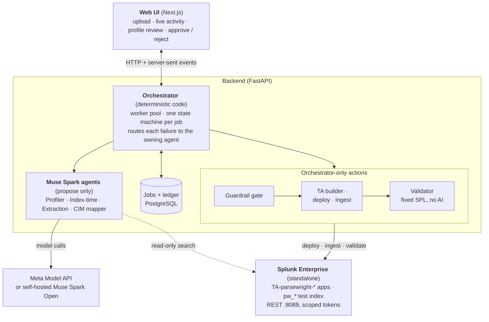
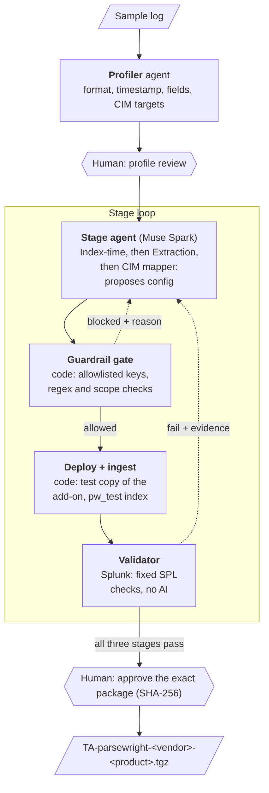
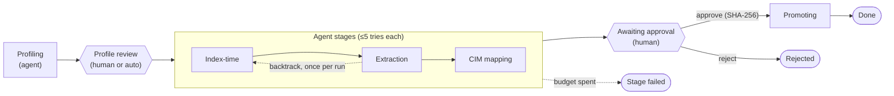
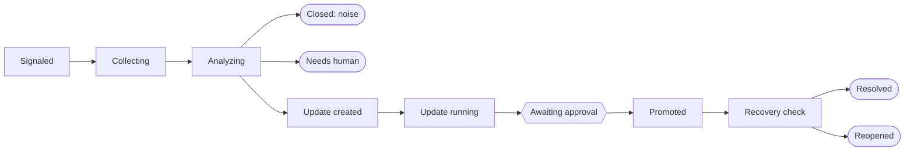

# Parsewright — Design Overview

> Source of truth for development. Last updated Nov 3, 2026. Sections and rows marked **planned** are designed but not built; everything else describes the code as it is. What is built is also listed in [features.md](features.md).

## Overview

Parsewright turns raw sample logs into a tested, CIM-compliant Splunk add-on (TA), deployed to Splunk Enterprise and packaged as a `.tgz`, with an AI agent doing the parsing work and Splunk itself verifying the result.

**Problem.** Every new data source in a SOC needs a parser: line breaking, timestamps, field extractions and CIM mapping. Writing and testing `props.conf` and `transforms.conf` by hand takes hours per source, and mistakes at index time corrupt data permanently.

**Solution.** A team of Muse Spark agents studies the logs, writes the TA stage by stage, deploys it to a standalone Splunk Enterprise instance, ingests the samples into a test index, and fixes its own work until fixed validation searches pass. A human approves before anything is promoted.

**Hackathon fit.** Meta Global AI Developer Hackathon, "Build for Your World" track: a problem known firsthand from daily Splunk and SOC work.

**Meta models.**

- Muse Spark (`muse-spark-1.3`, standard mode) via the Meta Model API for all agent reasoning
- Muse Spark Open for an on-prem mode: same code, a different `LLM_BASE_URL`, so logs never leave the network
- Muse Code to speed up the build

**One-line pitch:** from raw log to CIM-compliant add-on in minutes instead of hours, verified by Splunk, not by the model.

## Scope and design principles

The hackathon build targets one standalone Splunk Enterprise instance, four log formats and three CIM data models, polished rather than broad.

| In scope | Out of scope (for now) |
| --- | --- |
| Splunk Enterprise standalone (all-in-one) | Splunk Cloud, clusters, deployer, forwarders |
| Formats: JSON, key=value, syslog, CSV | XML, binary, exotic vendor formats |
| CIM: Authentication, Network_Traffic, Web | Other data models |
| TA in `/opt/splunk/etc/apps/TA-parsewright-<vendor>-<product>` | Production rollout across a fleet |
| Any log as uploaded: synthetic generator samples (checked against their truth manifest) and logs without one (checked mechanically, meaning approved by a human) | Committing real or customer logs to this public repo (only synthetic fixtures live here) |
| Logs supplied by upload (a drop folder is planned) | Automatic discovery of unparsed data inside Splunk (dropped: damaged samples, production data exposure) |
| Dedicated inputs; shared syslog feeds (routing by index-time sourcetype rename) planned | Writing inputs.conf (left to the input owner) |
| Parser updates for TAs built by Parsewright (drift monitoring planned) | Updating TAs not built by Parsewright (needs an overlay TA and app precedence handling) |

**Principles**

1. **The model reasons, the tools act, Splunk judges.** Agents propose configs; code deploys them; fixed SPL checks decide pass or fail.
2. **Agents never grade themselves.** An agent may search to investigate, but only the Validator moves the run forward.
3. **Orchestrated by code, not by an AI manager.** A deterministic state machine owns order, retries and budgets.
4. **Fresh, focused context per agent.** Agents never share a conversation; each gets a curated package from the run ledger.
5. **Score only what is achievable.** CIM checks count required fields and fields the source actually has, never fields the log never carried.
6. **Stop honestly.** When a budget runs out, the run ends with a clear report of what it could not solve.
7. **Human in the loop** at profile review and before promotion.

## System architecture

Three layers: a web UI, a FastAPI backend holding the orchestrator, agents and actions, and a standalone Splunk Enterprise instance reached only over REST.



Router and Drift Analyst agents are future enhancements; see Mixed feeds and Drift pipeline.

Agents only reason and search read-only; every write to Splunk goes through orchestrator code and the guardrail gate. The LLM endpoint is the Meta Model API by default, or a self-hosted Muse Spark Open by changing `LLM_BASE_URL`.

## AI agent architecture

Four Muse Spark agents (a Router for shared feeds and a Drift Analyst are planned) each own one part of the TA, return a strict schema-validated object, and are judged by their own checks. Agents never talk to each other or deploy anything.

| Agent | Job | Owns (writes) | Output | Judged by |
| --- | --- | --- | --- | --- |
| Profiler | Understand the logs | Nothing | `LogProfile` | Human profile review |
| Index-time | Split events and timestamp them | `LINE_BREAKER`, `SHOULD_LINEMERGE`, `TIME_PREFIX`, `TIME_FORMAT`, `MAX_TIMESTAMP_LOOKAHEAD`, `TZ`, `TRUNCATE` | Index-time stanza | Event count, parser warnings, `_time` accuracy |
| Extraction | Get the fields out | `KV_MODE`, `EXTRACT-`, `REPORT-` + `transforms.conf` | Search-time stanza | Field coverage, greedy-regex and duplicate checks |
| CIM mapper | Normalize to CIM | `FIELDALIAS`, `EVAL`, lookups, `eventtypes.conf`, `tags.conf` | CIM config | Required fields, allowed values, child datasets |

How one run moves through the agents, with each proposal gated by code and judged by Splunk:



**LogProfile contents:** format, multiline flag, timestamp example and format candidates, timezone hints, vendor/product guess, sourcetype name, field inventory with coverage, event categories, target CIM models. Every later stage builds on it, and its field inventory defines what CIM fields are achievable.

### Context each agent receives

| Agent | Gets | Does not get |
| --- | --- | --- |
| Profiler | Raw samples | Anything else |
| Index-time | Profile, samples, current index-time stanza, its own past failures | Extraction or CIM work |
| Extraction | Profile, correctly broken events from Splunk, current extraction config, its own past failures | Index-time history |
| CIM mapper | Profile, extracted fields with real values, CIM spec for the target model, its own past failures | Raw regex attempts |

The TA files on disk are the source of truth: each attempt reads them fresh rather than relying on the agent's memory of what it wrote.

Code prepares this context; agents do not call tools themselves. Search-time stages reuse the events indexed by the passing index-time attempt and only reinstall the add-on, so they cost no ingest.

### Tools

Agents call no tools: in the lab, forced tool calls returned HTTP 400 on the Meta Model API, and the context prepared by code (the table above) covers what they need. Two tools are built and used by code instead:

- **`test_regex`** runs inside the guardrail gate: an `EXTRACT-` regex that matches none of the sample events, or that backtracks catastrophically, is blocked, and the reason goes back to the agent. It uses the Python `regex` package, a close match to Splunk's PCRE; the Validator in Splunk stays the real proof.
- **`run_search`** (code-owned base search, command allowlist, 50 rows) is built and tested, ready for agents that investigate on their own.

Deploy, reload and ingest are orchestrator code only. The 1M-token context lets the CIM spec and large samples sit in one prompt without retrieval.

## Orchestrator state machine

A run moves through eight states in a fixed order; the agent stages each loop until their checks pass, and every transition is saved to PostgreSQL before the next step.



End states: **Done** (TA ready), **Stage failed** (an agent stage spent its budget; honest report), **Rejected** (a human rejected it; nothing is promoted) and **Error** (from any state; an unrecoverable infrastructure failure).

For shared feeds, an optional Routing state runs between Profile review and Index-time. Any agent stage that spends its budget goes to Stage failed. Two extra rules apply inside the stages: after a pass, earlier stages' checks re-run to catch regressions, and a later stage may send the run back to an earlier one once per run (for example, missing fields caused by merged events go back to Index-time).

Saving on every transition gives crash recovery (resume from the last state), the live UI (it reads state and ledger), and a full audit trail for the report and the demo.

## End-to-end workflow

A run goes from upload to an approved `.tgz` in eight steps; steps 4 to 6 each repeat an inner loop until their checks pass or their budget runs out.

1. **Intake.** A sample log is uploaded (UI, API or CLI). A job is queued (duplicates rejected), and a free worker claims it.
2. **Profile.** The Profiler reads the samples and returns a `LogProfile`.
3. **Profile review.** The user confirms or corrects vendor, product, sourcetype and timezone. Can be skipped per run, except when the timestamps carry no zone and none was stated.
4. **Index-time stage.** Line breaking and timestamps.
5. **Extraction stage.** Search-time fields.
6. **CIM stage.** Aliases, evals, lookups, eventtypes, tags.
7. **Approval.** The user reviews raw vs parsed events side by side (each extracted value highlighted in the raw line, `_time` next to the raw timestamp) and a raw value → field → CIM field → normalized value table, plus the scores and final configs. They approve or reject; a rejected run promotes nothing. Correcting a mapping from the report, sent back to the owning stage as evidence, is planned.
8. **Promote.** Code renames the approved package to its real names, installs it as `TA-parsewright-<vendor>-<product>`, runs a smoke test and registers the version.

### Inner loop for every stage attempt

1. **Generate:** the stage's agent gets its curated context and returns its config (schema-validated).
2. **Gate:** guardrails check it: a key allowlist with typed values and bounds, regex safety and scope. After install, any splunkd warning about the test add-on fails the attempt and becomes evidence. splunkd does not warn about unknown or misspelled keys, so the allowlist is the syntax control. No shell, sidecar or Docker socket ([lab-findings.md](lab-findings.md), Q7).
3. **Deploy:** install the complete `.tgz` under its test identity (see Test identity) through the `apps/local` REST endpoint with `update=true`, from a shared packages folder; never through the `configs/conf-*` endpoints, and no restart ([lab-findings.md](lab-findings.md#q6-deploy-path), Q6).
4. **Ingest:** post the samples to `receivers/simple` into the one shared test index, `PARSEWRIGHT_TEST_INDEX` (`pw_test`), created once at setup; the engine never creates or deletes indexes. A new sourcetype's index-time settings apply to the very next ingest with no reload. Each attempt has its own sourcetype (see Test identity), and every Validator search filters on it, so attempts and jobs never mix. Then wait until the event count is stable ([lab-findings.md](lab-findings.md), Q3, Q8 and Q9).
5. **Validate:** run that stage's fixed SPL checks, plus a quick regression re-run of earlier stages' checks.
6. **Decide:** pass moves to the next stage; fail returns to the same agent with evidence (expected, actual, up to 3 failing events).

### Failure handling

| Failure | Example | Response | Counts against budget |
| --- | --- | --- | --- |
| Bad output | Invalid JSON from the model | Ask again, same context | Separate cap of 2 |
| Guardrail block | Tried to write `inputs.conf` | Retry with the block reason | Yes |
| Infra error | Splunk REST timeout | Retry with backoff, no model call | No |
| Validation fail | `_time` off by 10,800 s on every event | Retry with evidence | Yes |
| Earlier-stage cause | Fields missing because events merged | Backtrack to the owning stage, at most once per run | Yes |

**Budgets:** 5 attempts per stage, a token/cost ceiling per run, 15 minutes wall-clock. The first limit hit ends the run in `STAGE_FAILED` with an honest report.

## Test identity

Every test deploy runs under a separate app name and a separate sourcetype name, so untested config never parses production data; the real names are restored by code only at promotion.

**Why.** `props.conf` stanzas are keyed by sourcetype. A test TA reusing the real sourcetype would merge with the installed TA, and Splunk precedence would decide which settings parse live data. The same applies to routing: a test rule attached to the real `[syslog]` stanza would reroute production events mid-test.

| Item | Production name | Test name |
| --- | --- | --- |
| App | `TA-parsewright-fortinet-fortigate` | `TA-parsewright-fortinet-fortigate__test_<job>` |
| Sourcetype (every stanza, eventtype and search in the copy) | `fortinet:fortigate:traffic` | `fortinet:fortigate:traffic__test_<job>_a<attempt>` |
| Transforms | `parsewright_<job>_…` | Same prefix plus `__test` |

Every attempt is a new sourcetype: the case the lab proved applies without a reload (Q3), and what separates attempts inside the one shared test index.

**Applies to** new builds and parser updates alike: samples are ingested into the test index with the test sourcetype, and test apps are removed with the job's other test resources.

**At promotion.** Code, never the agent, renames the tested package back to the real names. The human approves the test package's SHA-256; promotion derives the real package by code from exactly those approved bytes. Packages are built reproducibly, so the promoted hash is deterministic; both hashes are recorded and linked, and a smoke test runs right after promotion.

## Uploads

Each job takes a sample log from one log source, raw as the source writes it, plus optional form fields; the model learns from a sample while the Validator tests on the whole file.

**What to upload**

- One log source per job (e.g. a FortiGate traffic log), one file
- Formats in scope: JSON, key=value, syslog, CSV, as `.log`, `.txt`, `.json`, `.csv` or single-file `.gz`; no archives
- Raw as written by the source, not re-saved in Excel
- Minimum about 50 events; maximum 10 MB per job, measured after decompression
- Content checked on upload (text, UTF-8, line endings), not just the extension

**Optional form fields**

| Field | Why |
| --- | --- |
| Vendor / product | Naming and CIM mapping; otherwise the Profiler proposes them |
| Timezone of the logs | Prevents the classic +3 h error when timestamps carry no zone; without it, such a run asks in profile review |
| Skip profile review | Unattended runs |
| Update of a promoted TA | Starts a parser update instead of a new build |

Planned: how logs reach Splunk (file monitor, syslog, HEC), the current sourcetype, the target CIM model, and "shared feed?" for routing.

**Holdout test.** The agents see the first 200 events in time order (the generator mixes event types throughout, so every type is covered), and the CIM mapper's field values come from a `fieldsummary` over those same events. The Validator ingests the full file, so the parser is proven on events the model never saw ("learned from 200 lines, passed on 8,000").

**Drop folder** (planned; the intake helper that refuses symlinks is built). Each new subfolder is one job: the log files plus an optional `job.yaml` with the form fields.

**Getting samples out of Splunk** (when the user has no original file): a plain event search with `| head 500 | reverse`, then Export → Raw Events (or `splunk search … -output rawdata`, or the REST export endpoint with `output_mode=raw`). Before using it, check `max(len(_raw))` and `max(linecount)`: events cut at 10,000 characters are truncated and unusable. The original file on the forwarder or syslog collector is always the better sample.

**Going live** (planned). For a dedicated input, the approval report ends with the exact `inputs.conf` change (e.g. `sourcetype = fortinet:fortigate:traffic` on the input now sending `fw01-2`). Parsewright never writes inputs itself.

**Only the log is uploaded.** A generator sample is recognised by its content hash and validated against its own truth manifest from the repo (a manifest can also be uploaded, and is checked like any input). Any other log has no answer key and is validated mechanically (see "Validation without a manifest"). The demo uses synthetic logs only; the repo never holds real ones.

## Concurrency and continuous operation

Every unparsed log source becomes one job in a PostgreSQL queue, and a pool of long-running workers processes jobs in parallel, with database locks guaranteeing that no two workers ever handle the same logs.

### Intake

| Source | How jobs are created |
| --- | --- |
| Upload | The web UI, `POST /uploads`, or `parsewright run <file>` |
| Drop folder | Planned |

### No two workers on the same logs

1. **Claim with `FOR UPDATE SKIP LOCKED`:** a worker atomically sets a queued job to running with its `worker_id` and a lease; other workers skip locked rows.
2. **Duplicate prevention at intake:** a unique constraint on the source key (host + source path, or vendor/product) for active jobs, plus a content hash of the samples. A repeat upload points to the existing job.
3. **Unique sourcetype and TA name per job:** `props.conf` stanzas are keyed by sourcetype, so two TAs defining the same sourcetype would merge unpredictably.

### Operation never stops

| Situation | Behaviour |
| --- | --- |
| Job waits for human review | Worker releases it and takes the next job; the job is requeued when the human acts |
| Job spends its budget | Only that job ends in `STAGE_FAILED` |
| Worker crashes | Lease (~2 min) expires; another worker resumes from the last saved state |
| Worker is slow but alive | Heartbeat renews the lease |
| Service restarts | Workers run with an auto-restart policy; queued jobs persist in PostgreSQL |
| Production data | Untouched: reload not restart, testing only in `pw_*` indexes |

### Shared limits

- **Splunk writes** (app install, reload) run under one global lock, one job at a time; LLM calls and validation searches run in parallel.
- **Worker count** sized to Splunk's concurrent search limit: `parsewright serve --workers 4` by default.
- **LLM** calls limited to 2 at once, plus a per-job token budget, to protect rate limits and the API credits.

### Credit protection

Credits are spent only on jobs someone started, and always inside hard budgets.

| Control | What it prevents |
| --- | --- |
| Token estimate at upload; a log estimated over the per-run ceiling is refused | Surprise spend on a large sample |
| Sampling: the agents see 200 events, never the whole file | Sending whole log files to the model |
| Duplicate check by content hash | Paying twice for logs already parsed; a repeat upload points to the earlier job |
| Per-job token budget | One stubborn source draining credits |
| Global daily token budget (2M) and kill switch | Runaway spend; workers stop claiming jobs and the UI shows why |
| Spend limit on the Meta billing page | Anything the code misses |

In the lab, four uploads at once ran on four workers in parallel, one pausing for review while the others continued (`demo/04_parallel_jobs.sh`).

## Mixed feeds and sourcetype assignment (future enhancement)

> Not built: a future enhancement after the hackathon (Phase 9). The design is kept as the roadmap.

Parsing only works once events carry the right sourcetype, so Parsewright also handles how events get it, including shared feeds where many vendors arrive under one generic sourcetype such as `syslog`.

Every event in Splunk already has a sourcetype, often a meaningless one: set generically in `inputs.conf` (`syslog`), matched by a pretrained type, or invented from the file name (`fw01-2`, `fw01-too_small`).

### Two cases

| Case | Example | What Parsewright does |
| --- | --- | --- |
| Dedicated input | A forwarder monitoring `/var/log/remote/fw01/` only | No agent work: the approval report ends with the exact `inputs.conf` change to copy, e.g. `sourcetype = fortinet:fortigate:traffic` |
| Shared feed | UDP/TCP 514 with `sourcetype = syslog` carrying FortiGate, Cisco, Palo Alto and Linux | Runs the Routing stage to split the target vendor out by index-time rename |

Parsewright never writes `inputs.conf` itself; changing inputs stays with the person who owns them.

### Routing config the agent produces

```ini
# props.conf
[syslog]
TRANSFORMS-parsewright_route_fgt = parsewright_route_fortigate

# transforms.conf
[parsewright_route_fortigate]
REGEX = devid="?FG[0-9A-Z]+
DEST_KEY = MetaData:Sourcetype
FORMAT = sourcetype::fortinet:fortigate
```

### Two traps the agents must handle

1. **The new sourcetype's index-time settings do not apply to routed events.** Splunk breaks events and extracts timestamps before the routing transform runs, using the original `[syslog]` rules. Only search-time settings of the new sourcetype take effect. So for routed data, index-time settings go in a `[host::...]` or `[source::...]` stanza, or the Index-time agent confirms the generic parsing already handles the data (usually true for single-line syslog).
2. **A broad regex steals other vendors' events.** The rule sits on the shared stanza and touches all data in the feed, so misrouting damages other teams' data.

### Routing stage

An optional stage between Profile review and Index-time, run only when the feed is shared. The Router agent owns the routing regex and transform; it gets the profile, the mixed-feed sample and its own past failures, and may use `run_search` and `test_regex`.

| Check | How | Pass when |
| --- | --- | --- |
| Positive routing | Ingest the mixed sample as the generic sourcetype; count target events by sourcetype | 100% of target events carry the new sourcetype |
| Negative routing | Count non-target events that were renamed | Exactly 0 |
| Index-time on routed data | `_time` and event count checks on the routed events | Same rules as the Index-time stage |

The negative test needs the whole mixed feed, not only the target device, so the upload includes it (or the generator produces a synthetic multi-vendor feed with a manifest of which line belongs to which vendor).

### Upload form additions

| Field | Effect |
| --- | --- |
| Current sourcetype (e.g. `syslog`, `fw01-2`) | Used to ingest test data exactly as production receives it |
| Shared feed? | No: Case 1, `inputs.conf` instruction only. Yes: Routing stage runs |

### Guardrail exception

The key allowlist normally blocks touching generic stanzas. One narrow exception: a `TRANSFORMS-` entry on the generic stanza is allowed only when its transform has `DEST_KEY = MetaData:Sourcetype`. Routing becomes possible; nothing else on the shared stanza is.


## Parser updates

When a log format changes, an update job patches the existing TA with the smallest change that works, and must prove that both the old and the new format still parse, because after a firmware upgrade both usually coexist for a while.

**TA registry.** Every TA that Parsewright builds is stored with its versions, original samples, truth manifest and baseline. The old samples become the regression set, so they are kept for as long as the TA exists.

**Update flow**

1. **Select and upload.** Pick a registered TA and upload new-format samples (automatically from the drift pipeline, when that is built).
2. **Diagnose, no AI.** The current TA is tested on the new samples with the normal Validator, producing a drift report (e.g. timestamps fail, `srcip` renamed `src_ip`, new action value `deny-policy`). If everything passes, the job ends with zero credits spent.
3. **Patch mode.** Only agents owning failing checks run. Each gets the current config, the drift evidence and the instruction to make the minimal change (add a timestamp format, extend a regex), never a rewrite.
4. **Regression.** The patched TA must pass on the old registry samples and the new samples. Breaking the old format rejects the attempt with evidence.
5. **Review.** Line-by-line diff against the production version, raw vs parsed for an old and a new event, version bump in `app.conf` (e.g. 1.2.0 → 1.3.0), hash-bound approval, rollback to the exact previous version.

**Promotion of an update.** The app is updated in place via REST: `default/`, `metadata/` and `lookups/` are replaced; `local/` (admin overrides) is kept and never written by Parsewright; the previous version stays in the registry for rollback. Before promotion, Parsewright checks the installed TA's `local/` files: if any override a setting the patch changed (e.g. an old `TIME_FORMAT` in `local/props.conf`), the review flags that the fix will not take effect until a human updates or removes the override. Search-time changes apply to past events immediately; index-time changes apply only to data indexed after the reload.

**Job type:** update, with states Diagnose → failing stages only → Regression → Approval → Promote.

**As built.** The update job installs the production TA from its kept, hash-checked package under the job's test identity, and ingests the new samples and every registered version's samples under one test sourcetype per attempt, told apart by `source`; every check runs on every set. A later stage that passes as it is is not patched. A patch may add eventtypes but never drop or rename a production one. Updates are a minor version above the highest registered version (so an update after a rollback never reuses a number). Promotion uses `update=true` only over a TA the registry lists at the expected version whose installed `app.conf` carries the Parsewright marker; the lab confirmed `update=true` keeps `local/` ([lab-findings.md](lab-findings.md), Q11). Overrides are flagged by comparing the effective settings with the TA's own `default/`, and with Splunk's documented defaults for keys the TA does not set. After the in-place install the effective settings are read back, and a changed key that is not in effect fails the smoke test. Registered samples are read only from the engine's private runs folder, never through a link, and only while their intake hashes still match. Promotions and rollbacks of one TA run under one lock. Rollback is CLI only: `parsewright rollback <TA> <version>`.

**Out of scope:** updating TAs not built by Parsewright. Editing a Splunkbase vendor TA directly is lost on the vendor's next upgrade; the right approach, a separate overlay TA, depends on Splunk app precedence and is left for later.

## Drift pipeline (future enhancement)

> Not built: a future enhancement after the hackathon (Phase 8). Parser updates, which it would trigger, are built; today a person starts them with a new sample.

Parsewright watches the parsers it built: Splunk alerts detect a format change for free, code collects masked samples, a Drift Analyst agent decides whether the change is real, and an update job is created automatically, so the only manual step is approving the fix.

Example used below: a FortiGate firmware upgrade changes the log format at 14:00.

### Steps

0. **Setup at promotion.** The registry stores a baseline (field coverage, CIM values seen, eventtype match rate, volume). Alert searches are installed in a separate Parsewright monitoring app from fixed templates with only the sourcetype and baseline numbers filled in; no agent writes them. Splunk's scheduler runs them (e.g. every 15 minutes); Parsewright spends nothing until one triggers.
1. **Alert fires (14:15).** Splunk's webhook alert action posts TA ID, signal, sourcetype, count and window to FastAPI. The endpoint uses a secret token in the URL and accepts only the Splunk server's address, since the webhook cannot send auth headers.
2. **Dedup and grouping (code).** Signals for a TA with an open drift job attach to it; signals within minutes become one job; a TA closed as noise in the last hour is in cooldown.
3. **Collection (code, no AI).** With a read-only account limited to registered sourcetypes: change point (`timechart span=5m` of failing vs normal), affected hosts (e.g. 7 of 20, a partial rollout), failing samples grouped by shape, normal events from the same window, truncation check. Values are masked with consistent, format-preserving fakes, so regexes built from them still hold; the masking map also gives partial ground truth.
4. **Drift Analyst agent.** Gets only the evidence bundle and one narrow tool, `fetch_more_samples(pattern, n)`, run by the collector with masking. Returns verdict, change start, affected hosts, summary, stages affected, representative samples and confidence. Code also requires sustained volume (more than N events over more than M minutes) before a real-change verdict counts.
5. **Update job created.** New samples from the analyst, old samples from the registry, only the affected stages; then the parser update flow.
6. **Human approval.** Notification (UI badge for the hackathon; email or Slack later); review shows the drift report, the diff, and old and new events passing.
7. **Recovery.** The alerts must go quiet for the next runs, then the job closes as resolved, or reopens with new evidence. The baseline is updated. A damage report states that search-time fixes apply to past events but index-time fixes do not (e.g. "12,340 events indexed 14:02–14:41 have wrong timestamps; re-ingest from source if needed").

### Detection signals

| Signal | Catches |
| --- | --- |
| `DateParserVerbose` warnings for the sourcetype | Timestamp format change |
| Line-breaking warnings for the sourcetype | Event structure change |
| Key field coverage below baseline | Renamed or moved field |
| CIM values outside the allowed set | New vendor values |
| Rising events with no eventtype or tag | New event types |

### Analyst outcomes

| Verdict | Result |
| --- | --- |
| Noise | Closed with explanation; cooldown starts |
| Needs human | Truncated events or low confidence: asks for a raw file upload |
| Real change | Update job created automatically |

### Drift job states



Same PostgreSQL queue, locking, persistence, budgets and kill switch as build jobs.

### Production access, deliberately narrow

Unlike the dropped discovery idea, drift monitoring only reads sourcetypes Parsewright built, and samples are usually intact because a timestamp or field change leaves `_raw` untouched. Masking (or on-prem Muse Spark Open) applies before any model call.

**Credits:** detection, dedup and collection use none; the Analyst runs once per drift job; the update job runs only affected stages.


## Validation design

The Validator is code plus fixed SPL, no AI: it runs searches through the Splunk Python SDK (`jobs.oneshot`, JSON output) and applies a pass/fail rule to each result.

**Mechanics**

- Wait for indexing: poll `| tstats count where index=<test_index>` until two consecutive polls match.
- Always search `earliest=0`, because samples carry historical timestamps.
- Ground truth comes from the synthetic generator's truth manifest (event count, true epoch per event, true field values). For logs without a manifest, the mechanical checks below stand in.

### Validation without a manifest

The agents still do all the work, and the Validator still runs on every event of every attempt, in Splunk; only the answer key changes. Code (never the AI) proves what can be proven from the file itself, and the approval report lists what only meaning can settle.

| Stage | Check | Pass when |
| --- | --- | --- |
| Index-time | Event count | One event per record of the file (non-empty lines; for multi-line logs, lines where a timestamp starts) |
| | Timestamp accuracy | `_time` equals the time written in each event's own line, read by code with the add-on's `TIME_PREFIX`, `TIME_FORMAT` and `TZ` (epoch and ISO 8601 when Splunk recognises the timestamp itself) |
| | Timezone | When the timestamps carry no zone (decided by code: an epoch or a trailing `Z`/offset carries one), `TZ` is the zone a human stated, on the upload form or in profile review. With none stated, the run pauses in profile review, even when review was skipped |
| | Fallback, parser warnings, `TIME_FORMAT` matches | As with a manifest |
| Extraction | Values | Every value appears exactly in its own raw line, trimmed, and does not run into another field (`key=`/`"key":` inside a value) |
| | Coverage, duplicates | Each profile field at its stated coverage; single-valued |
| CIM | Membership | Events reach every data model the add-on tags (no tag: fail) |
| | Required fields, allowed values | Every required field the add-on maps is filled on every event, with only allowed values |
| | Constants | No CIM field fixed to one value while its source field varies |
| | Child datasets | `Failed_Authentication`, `Blocked_Traffic`, … agree with the `action` values |
| CIM (both modes) | Values from the event | Every value the add-on writes into a CIM field occurs in its own raw line, or is one of the field's allowed CIM values (`action=blocked`); only fields constant by design (`vendor_product`, `vendor`, `product`, `app`) are exempt |
| | Directions | No source field feeds both ends of a pair (`src`/`dest`, `src_port`/`dest_port`, `bytes_in`/`bytes_out`, …) |

The last two rows run with a manifest too: a manifest only lists the CIM fields its source has, so a required field filled with the wrong meaning (found in the lab: `src_port` read from `dest_port`, an invented `rule=vpn-access`) passed both modes before.

Parser updates without a manifest: Diagnose snapshots what production gives each registered sample set, and every later check on those sets is exact equality with that snapshot (times, fields, CIM values, matched as multisets so repeated timestamps are fine). New samples without a manifest get the mechanical checks and inherit production's `TZ`.

**What it cannot prove: meaning.** A plausible but wrong timezone that nobody stated, a field mapped to the wrong CIM field, `drop` mapped to `allowed`. The approval report therefore shows "Decisions the agents made" (how the timestamp is read with the first event's result, field meanings, and each source value → CIM value with its count), and approval is where a human vouches for them. The report states which validation ran.

### Index-time checks

| Check | How | Pass when |
| --- | --- | --- |
| Event count | `\| tstats count where index=<idx>` | Equals manifest count |
| Parser warnings | `index=_internal sourcetype=splunkd log_level=WARN` for `DateParserVerbose`, `LineBreakingProcessor`, `AggregatorMiningProcessor` on the test source | Zero |
| Timestamp fallback | Events with abs(`_indextime` − `_time`) < 60 s | Zero |
| Timestamp accuracy | `_time` per event vs manifest epoch | All match |
| `TIME_FORMAT` matches | Code (no SPL): every raw event's timestamp, at `TIME_PREFIX` within `MAX_TIMESTAMP_LOOKAHEAD`, matches `TIME_FORMAT` translated to a pattern | All match. When it does not, Splunk silently guesses the timestamp and can still get `_time` right, so the other checks pass by luck (found in the lab). With no `TIME_FORMAT`, the gate requires `TIME_PREFIX` and `MAX_TIMESTAMP_LOOKAHEAD`: that is how two formats coexist in one sourcetype after an upgrade |

### Extraction checks

| Check | How | Pass when |
| --- | --- | --- |
| Field coverage | `\| fieldsummary` vs the profile's field inventory | Each field at its expected coverage |
| Greedy regex | Values containing delimiters or outlier lengths | Zero events |
| Duplicates | `mvcount(field) > 1` where single-valued is expected | Zero events |
| Value spot-check | Extracted vs manifest values on a sample | All match |

### CIM checks

| Check | How | Pass when |
| --- | --- | --- |
| Reaches the model | `\| tstats summariesonly=false count from datamodel=<Model> where index=<idx>` | Count equals expected events |
| Required fields | `\| datamodel <Model> <Dataset> search` + count per required field | Every required field the source has equals total |
| Allowed values | e.g. `Authentication.action` not in success, failure, unknown | Zero events |
| Child datasets | Failures land in e.g. `Failed_Authentication` | Counts match manifest categories |

**CIM scoring rule (no Vladiator-style false failures):** a field counts as missing only if CIM expects it *and* the source contains it. The report shows three numbers: required fields passed, available fields mapped, and fields not in the source (informational, no penalty). Required fields and allowed values are pinned in `cim_spec/`, never chosen by the model: read from the CIM add-on's own data model definitions (Splunk_SA_CIM 8.7.0; each field's `recommended` flag and `expected_values`) by `python -m parsewright.cim_spec.pin`. Required = the root dataset's recommended fields. Data model rows are read with `| datamodel <Model> <Dataset> search | search sourcetype=<attempt>`: the model's output has no `index` field, so the attempt's unique sourcetype is the filter.

**Splunk prerequisite:** the CIM index macros (e.g. `cim_Authentication_indexes`) must include `pw_*`, or CIM checks fail falsely. `make up` sets this; on your own Splunk, set it once.

**Feedback to the agent** is compact: stage, failed check, expected, actual, up to 3 sample events. Precise evidence such as "+10800 s on 40/40 events" points straight at the fix (a wrong `TZ`).

## Guardrails and security

An AI with write access to Splunk is a risk, so every agent output passes a deterministic gate that checks values as well as keys, the workflow itself is tamper-proof, and every Splunk call uses a narrowly scoped account. The Status column says what is built; each built guardrail has adversarial tests in `engine/tests/`.

### Config safety (keys and values)

| Guardrail | Stops | Status |
| --- | --- | --- |
| Key allowlist: parsing keys only | `inputs.conf`, `commands.conf`, anything that executes code | Built |
| Block `DEST_KEY = queue` / `nullQueue` | Silent deletion of events | Built |
| Block `_TCP_ROUTING` and `_MetaData:Index` | Data sent to another output or index | Built |
| Block `INGEST_EVAL` and `SEDCMD-` | Permanent index-time changes to `_raw` or fields | Built |
| Min/max bounds on `TRUNCATE`, `MAX_EVENTS`, `MAX_TIMESTAMP_LOOKAHEAD` | Giant events and pipeline memory problems | Built |
| `EVAL-`/`FIELDALIAS-` may not target `index`, `host`, `source`, `sourcetype`, `_time`, `_raw` | Corrupting core fields for every search | Built |
| No `[default]`, no broad `[source::...]` or `[host::*]` | Changing parsing for all data | Built |
| No lookups: `LOOKUP-` and `lookup()` are refused | External lookups that run scripts | Built |
| Routing exception: a `TRANSFORMS-` on a generic stanza only with `DEST_KEY = MetaData:Sourcetype`, and 0 misrouted events in the negative test | Any other change to a shared stanza | Planned, with routing |
| Key allowlist with typed values before deploy, plus a post-install splunkd-warning check that fails closed: any warning about the test add-on fails the attempt (lab Q7) | Syntax errors, unknown or mistyped keys | Built |
| Regex catastrophic-backtracking test | Stalling the parsing pipeline | Built |

### TA builder

| Guardrail | Stops | Status |
| --- | --- | --- |
| Reject newlines in values; one escaping conf writer | A value injecting a new stanza such as `[script://…]` | Built |
| Names match `^[a-z0-9_:-]+$`; code adds the fixed prefix `TA-parsewright-` and the pattern applies only to the vendor and product parts; resolved paths must stay inside the TA folder | Path traversal out of the app | Built |
| Package file allowlist: `default/`, `metadata/`, `lookups/` (CSV), `README`, `app.conf` | `bin/` scripts, `appserver/static` JavaScript in Splunk Web | Built |
| Prefix every transform `parsewright_<job>_`; collision check by reading existing transform names over REST (`configs/conf-transforms`) before deploy (lab Q7) | Overriding another app's global transform name | Built |
| TA named `TA-parsewright-<vendor>-<product>`; refuse if the name exists | Overwriting (and later deleting) a Splunkbase vendor TA | Built |

### Validator integrity (no gaming)

| Guardrail | Stops | Status |
| --- | --- | --- |
| Flag CIM fields with one constant value where the source varies; every CIM field must trace to a source field or an approved constant | `EVAL-action = "success"` passing the allowed-values check | Built |
| Manifest value checks and provenance shown in review | Unrelated fields aliased just to fill required fields | Built |
| Holdout test on the full file; flag literal sample values in regexes | Regexes overfitted to the sample | Built |
| Agents have no file tools; the builder writes only inside the TA | Agents editing `cim_spec/`, manifests or the Validator | Built |

### Untrusted input

| Guardrail | Stops | Status |
| --- | --- | --- |
| Logs, form fields and `run_search` results passed as data, never instructions | Prompt injection planting a backdoor config | Built |
| Schema validation of every agent output | Malformed or malicious proposals | Built |
| Human correction text passed as data | Injection through review comments | Built |
| Cap decompressed size; single-file `.gz` only, no archives | Decompression bombs, zip-slip | Built |
| Content-based file checks (text, UTF-8) | Binary or disguised files | Built |
| Never follow symlinks at intake | A drop-folder link to `/etc/shadow` being read and sent to the model | Built (intake helper; the drop folder is planned) |
| Secret scan of samples; warning banner and masking option for real logs | Passwords or tokens in logs reaching a hosted model | Planned (README warns against real logs) |

### Splunk resources

| Guardrail | Stops | Status |
| --- | --- | --- |
| Per-job and daily byte caps on test ingestion | Test data consuming the Splunk license | Built |
| One shared test index, created at setup; the engine never creates or deletes indexes, and removes each job's test add-on after the run | Disk exhaustion; deleting resources that existed before | Built |
| Code rejects any ingest target not starting with `pw_` | Test data landing in a real index | Built |
| Code owns the base search (`search index=<test index> sourcetype=<own attempt sourcetype>`); a search may only append a `|` pipeline of allowlisted commands (`stats`, `eval`, `where`, `table`, `fieldsummary`, `head`, …), 50 rows, short timeout; commands that start a new result set (`tstats`, `datamodel`, `inputlookup`, `join`, `append*`, …) are refused and stay with the Validator's fixed SPL (T1.2) | `delete`, `collect`, `dbxquery`, `loadjob`, custom commands, other apps' lookups, reading other jobs' samples | Built |
| Rollback reinstalls the exact previous registered version (`parsewright rollback <TA> <version>`) | A bad update staying in production | Built (routing-transform cleanup planned, with routing) |

### Workflow integrity

| Guardrail | Stops | Status |
| --- | --- | --- |
| Approval bound to the SHA-256 of the exact `.tgz`; promotion deploys only that hash; any later change needs re-approval | A TA modified between validation, approval and deploy | Built |
| State transitions enforced in the database (`UPDATE … WHERE status = 'awaiting_approval'`) | Skipping validation or approval; replayed approve or promote requests | Built |
| Before ingesting, assert the attempt's sourcetype has 0 events in the shared test index, else bump the attempt number; never reuse a sourcetype, including on resume (T4.5) | Duplicate events after a retried ingest failing the count check | Built |
| On resume after a crash, remove the job's own test add-on before the attempt reinstalls it | Acting on an ambiguous deploy outcome | Built |
| Adversarial regression suite (`nullQueue`, newline injection, path traversal, injected log lines, constant-value gaming) run on every change | Old bypasses returning | Built |
| Ledger records model version, Validator version, CIM spec hash and artifact hash per run | Results that cannot be reproduced | Planned (package hashes are recorded) |
| Append-only ledger | Edited audit history | Built |
| Timeouts on every Splunk and model call | Hung workers | Built |
| Test identity: separate app and sourcetype names for every test deploy; rename back by code at promotion with both hashes linked and a smoke test | Untested config or routing rules parsing production data during testing | Built |

### Secrets and platform

| Guardrail | Stops | Status |
| --- | --- | --- |
| `.env` in `.gitignore`, `.env.example`, pre-commit secret scan | Tokens and API keys in the public repo | Built |
| No credentials in prompts; redaction in logs and ledger | Secrets leaking through the model or audit trail | Built |
| Log text rendered only as escaped text; highlights built as React elements | XSS from `<script>` in log lines in the raw vs parsed view | Built |
| Login; approve and promote need an approver role | Anyone reaching the API approving changes | Planned (localhost only today, R1) |
| Approval needs a second confirmation; high-risk changes (routing on shared stanzas) flagged | Risky approvals looking routine | Built (routing flag planned) |
| Pinned dependencies with hashes, images by digest | Supply-chain drift in the public repo | Planned (R12) |

### Splunk service accounts (token auth)

| Account | Used by | Can |
| --- | --- | --- |
| `parsewright_search` | Agents' `run_search`, the Validator | Search only `pw_*` and `_internal` |
| `parsewright_deploy` | Orchestrator code only, never a model | Install and update apps, reload, oneshot into `pw_*` |
| `parsewright_drift` | Drift collector code only (planned; `make up` already creates the account) | Read-only, role search filter limited to registered sourcetypes |

The deploy role's capabilities for app install were confirmed in the lab ([lab-findings.md](lab-findings.md), Q9), and `make up` creates all three accounts with a fresh 7-day token each.

### Deferred

Per-resource authorization and approver ≠ submitter (multi-team use), upload rate limits, TLS verification and token rotation (the lab uses self-signed certificates), data retention policy (samples kept while the TA exists; uploads deleted after the job), PostgreSQL backups.

In the lab, an injected instruction in a log line, a gate-blocked proposal and a constant `action` caught by the Validator are reproduced by `demo/03_guardrail_block.sh`.

## Build details

Plain Python, no agent framework: the flow is fixed and small, and readable code is easier to debug under deadline and easier for judges to review.

### Tech stack

| Layer | Choice |
| --- | --- |
| LLM client | `openai` SDK, `base_url=https://api.meta.ai/v1`, model `muse-spark-1.3` (env vars `LLM_BASE_URL`, `LLM_MODEL`) |
| Schemas | `pydantic` |
| Backend | FastAPI |
| Splunk | `splunk-sdk` over REST :8089, token auth |
| Ledger | PostgreSQL: job queue and ledger, written on every state transition |
| UI | Next.js + shadcn/ui, live updates over server-sent events from FastAPI |
| Lab | Splunk Enterprise standalone on a VM |
| Judges | `docker-compose.yml` with the official Splunk Enterprise image + the app |

### Platform and UI

Decision: a Python engine behind FastAPI, with a Next.js UI. The engine also runs headless (`parsewright run samples.log`).

The UI only reads job state and the ledger and sends the allowed actions (upload, confirm profile, approve, reject); it holds no logic. FastAPI streams ledger events to the browser as they happen. Every ledger log event carries `stage`, `attempt`, `visit`, `actor` (the agent, the gate, the orchestrator, the Validator or the human), `kind` (proposal, guardrail block, deploy, ingest, check pass or fail, evidence, backtrack, human wait, budget, info) and a structured `detail` (proposed settings, check results), written by `orchestrator/events.py`; the UI reads these fields and never parses the text line, which stays for the CLI.

| Screen | Shows | Actions |
| --- | --- | --- |
| Runs board | All jobs with the current phase, the agent at work, attempt x/5, tokens and status; "Needs you" jobs pinned; "New run" as a side sheet (new TA or update) | Start run |
| Run workspace | Budget meters, a "Now" banner naming the acting agent, a clickable and deep-linkable phase rail (`?phase=&attempt=`), each attempt's proposal, gate verdict, Splunk checks and outcome, the diff from the previous attempt, backtracks, and the activity feed grouped by phase and attempt | None (watch) |
| Profile review | The Profiler's findings with field coverage; inline corrections marked "you changed this" | Confirm |
| Approval report | CIM meters, attempts per phase, holdout; how the run was validated and the decisions the agents made; raw vs parsed with one colour per field and a CIM view; configuration as readable rows; for an update, the row diff against production, `local/` overrides and the rollback command | Approve (SHA-256, second confirmation), reject, download `.tgz` |
| TA registry | Every promoted add-on with all its versions | None (read-only) |

Every actor has one identity in the UI (`web/lib/actors.ts`): AI agents, code, Splunk and the human differ in avatar shape and badge, not only colour. Diffs are row-tinted with an icon and a word per row and never show unified-diff markers; the tested configuration is shown as the .conf file in an editor-style pane. The UI uses one dark glass theme. Runs recorded before the event labels are read from their text lines by a display-only fallback (`web/lib/legacy.ts`). Parser-update Diagnose is shown as Validator and Orchestrator work (no AI); a Drift Analyst identity is ready for the planned drift pipeline.

Planned: send ledger events to a `pw_audit` index with a small Splunk dashboard, so SOC teams can monitor agent activity in Splunk.

### Repo structure

```
engine/parsewright/
├── api/              FastAPI routes, upload checks, server-sent events
├── orchestrator/     run loop, parser updates, workers, approval and promotion, report
├── agents/           LLM client; profiler, index_time, extraction, cim_mapper (prompt + schema each)
├── tools/            Splunk client, search guard, test_regex, lab probes
├── guardrails/       index-time and search-time gates, final package gate
├── validator/        fixed checks per stage; mechanical checks for logs without a manifest
├── ta_builder/       escaping conf writer, naming, reproducible .tgz packaging
├── ledger/           PostgreSQL queue, ledger and TA registry (migrations)
├── cim_spec/         required fields + allowed values per model, pinned
└── generator/        synthetic logs + truth manifests; fixtures/
web/                  Next.js UI
docker-compose.yml    Splunk Enterprise, PostgreSQL, engine, web
```

### Hackathon compliance checklist

- [x] Meta Model API credits claimed (owner: confirm the spend limit on the billing page)
- [x] Fresh public repo, first commit on Oct 27; all code written Oct 27 to Nov 4
- [x] Only synthetic or self-generated logs; no client data anywhere
- [x] Meta models do the core reasoning (Muse Spark runs every agent)
- [x] 3-minute demo video showing only hackathon-built features, recorded Nov 3 (script: [demo-script.md](demo-script.md))
- [ ] Video link in the README
- [ ] Submit by Nov 4, 9:00 PM ET

### Decisions from the lab

Each was tested against the real Meta Model API and Splunk; details and evidence in [lab-findings.md](lab-findings.md).

- **Structured output:** `response_format` with a strict JSON schema works and is what every agent uses. The model reasons before answering, so output caps leave room for it (Q1).
- **Standard mode, not contributor mode:** contributor-mode variants are discounted but Meta may train on the content, so they are not used for anything but synthetic-only dev runs (Q2).
- **Index-time settings apply without a reload** to the next `receivers/simple` ingest of a new sourcetype (Q3).
- **Edge cases:** in scope: multiple event types per file, missing timezone, epoch timestamps. Multi-line logs are handled but not lab-tested. Out: CSV `INDEXED_EXTRACTIONS`; CSV is parsed at search time (Q4).
- **Four agents, not three:** focused context, single-owner failure routing, and no CIM gaming through extractions (Q5).
